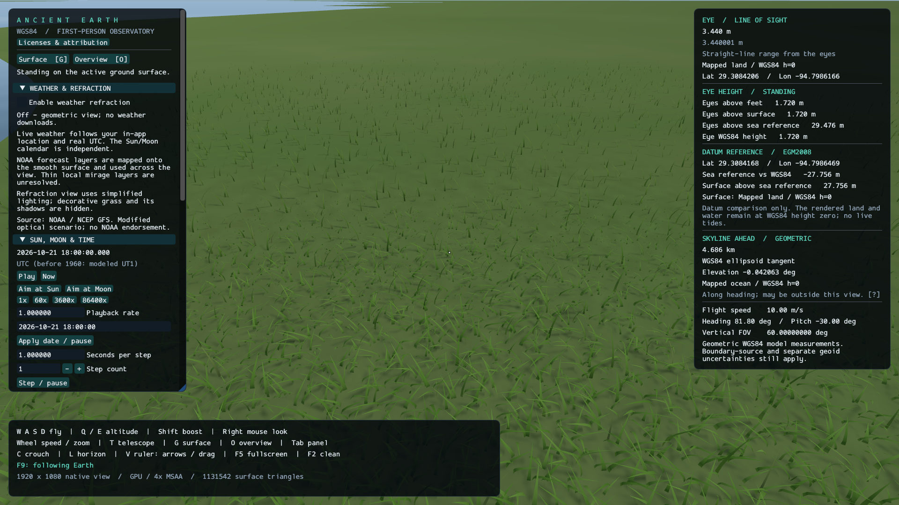
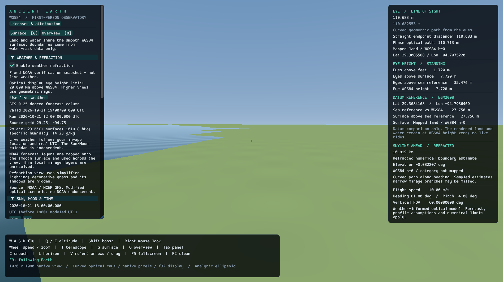
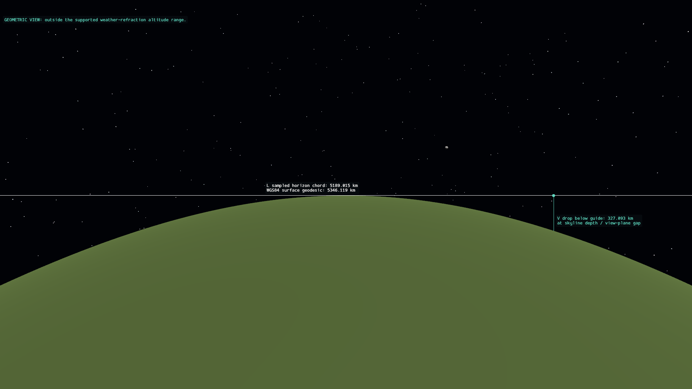

# Ancient Earth

A native first-person Earth explorer built with **Rust, Bevy 0.20.0 and Dear ImGui** through the `dear-imgui-rs` / `dear-imgui-bevy` 0.21.0 integration. Land and water share a smooth WGS84 ellipsoid. Regional water masks supply boundaries without topographic heights or photographic imagery. The app includes procedural materials, nearby grass, shadows and a time-controlled Sun and Moon. GPS navigation remains; city catalogs, pins and named location shortcuts have been removed. Positions, camera rays, flight and measurements use a separately tested double-precision math library.



<details>
<summary>More native screenshots: weather controls and clean-view measurement guides</summary>

Weather refraction enabled with the explicitly labeled fixed NOAA verification snapshot:



F2 clean view with L/V guides; this high-altitude view explicitly uses geometric fallback:



These unmodified 1920×1080 captures were taken from the running app on 2026-10-21. Source credits and redistribution terms are recorded in [NOTICE.md](NOTICE.md) and [the asset inventory](licenses/assets.json).

</details>

- [Stack](#stack)
- [Getting started and controls](#getting-started)
- [Earth model, sources and calculations](#earth-model-sources-and-calculations)
- [Accuracy and scope](#accuracy-and-scope)
- [Further documentation](#documentation)
- [Validation commands](#validation)

## Stack

Versions below describe the project's manifests and lockfile. The Dear ImGui version numbers refer to the Rust integration crates.

| Component | Version / choice | Role |
| --- | --- | --- |
| Language and toolchain | Rust 1.97.1, edition 2024 | Native application, with `rustfmt` and Clippy pinned by [rust-toolchain.toml](rust-toolchain.toml). |
| Engine | Bevy 0.20.0 | Application scheduling, window, input, GPU 3D rendering and screenshots. |
| GUI | `dear-imgui-rs` 0.21.0 and `dear-imgui-bevy` 0.21.0 | Dear ImGui coordinate entry, settings and measurement overlays. |
| Graphics backend | `wgpu` 30.0.1, through Bevy PBR | Native-resolution terrain meshes, antialiasing, lighting and shadows using the platform graphics backend. |
| Scientific geometry | Local [`earth-math`](crates/earth-math), GeographicLib Rust 0.2.7 | Authoritative `f64` geodesy, observer state, intersections, projections and measurements; GeographicLib supplies ellipsoidal geodesic distances. |
| Geoid decompression | `flate2` 1.1.10 | Loads the losslessly compressed offline EGM2008 grid. |
| Optional weather | NOAA / NCEP GFS through NOMADS | Current forecast profiles for the in-app observer location; explicit enable/disable toggle and provider timestamps. |
| Weather decoding and transport | `grib` 0.18.2, `ureq` 3.4.2 with Rustls, `ring` 0.17.14 | Pure-Rust GRIB decoding, bounded HTTPS downloads and SHA-256 cache integrity. |
| Data serialization | `serde_json` 1.0.154 | Writes frame-capture diagnostics. Serde remains a transitive dependency; the catalog's direct dependency was removed. |
| Earth geometry standard | NGA WGS84 reference ellipsoid | Defines the dimensions and coordinate model explained below. |
| Surface | NGA WGS84 ellipsoid | Common height-zero reference for land and water; topographic elevation files are not loaded. |
| Water classification | Copernicus Water Body Masks | Four regional categorical maps and reconstructed borders; no DEM or imagery input. See [water methods and limits](docs/science/water.md). |
| Surface appearance | Original procedural materials and grass | No photographic map layer. Materials are illustrative, not a surveyed land-cover classification. |
| Astronomy | Bundled JPL DE440s, IERS tables through Astropy, ERFA-derived orientation | Offline Sun/Moon positions and Earth rotation; sources, date coverage and uncertainty are documented in [astronomy](docs/science/astronomy.md). |
| Optional data preparation and verification | Python 3, Rasterio, PyProj, SpiceyPy and PyERFA | Source-data preparation and independent scientific checks. These tools are not needed to run the app. |
| Validation | Rust tests, Clippy, `rustfmt`, GitHub Actions | Checks scientific calculations, GPS navigation and desktop integration. |

Direct dependency requirements live in [Cargo.toml](Cargo.toml); [Cargo.lock](Cargo.lock) records the resolved versions, including transitive dependencies. Use `--locked` for reproducible dependency selection.

The GPU draws at the window's native resolution; the dedicated math library remains the authority for positions, collision and measurements. The GUI uses Dear ImGui throughout. Surface and astronomy data are embedded; optional live weather connects directly to NOAA. There is no application server or database. See [architecture](docs/development/architecture.md), [rendering mathematics](docs/science/rendering.md) and [data attribution](NOTICE.md). Earlier elevation/photographic assets and screenshots remain as historical source material with their original notices; the current renderer does not load them.

## Getting started

```powershell
cargo run --release --locked
```

Rust 1.97.1, a desktop graphics driver, and a C++ toolchain are required. On Windows, install Visual Studio Build Tools with **Desktop development with C++** and CMake. The first build downloads dependencies. The base app works offline; enabling live weather requires NOAA access.

If Windows reports missing Vulkan SDK layer JSON files, see the [tested DirectX 12 launch workaround](docs/user-guide.md#windows-startup-diagnostics).

The app opens in a generic globe overview. **Land & Water → Show mapped land / water** toggles the regional classification layer. **Coast view** opens a view derived from a loaded land/water boundary. The window starts at **1920 × 1080**; **F5** switches to fullscreen at the monitor's resolution and back to the previous window size.

**Sun, Moon & Time** starts at the current system date and time. Use **Pause / Play**, **Now**, playback rate presets, an editable calendar date, and a signed step count with seconds per step. Calendar entry is UTC except before 1960, when the historical time model is identified in the panel. Ephemeris coverage is finite; the panel displays the applicable Earth-rotation quality. See [astronomy](docs/science/astronomy.md) for the supported interval and scientific limits.

Eclipse geometry and shadows remain active at your coordinates and selected date. Named location demonstrations have been removed. See the [eclipse model and limits](docs/science/eclipses.md).

Start in the generic coast inspection view:

```powershell
$env:WGPU_BACKEND = "dx12"
cargo run --locked -- --coast
```

Add `--ground` to place your feet on the smooth surface. The regional masks do not provide worldwide land/water coverage. For a repeatable daylight view:

```powershell
.\target\debug\ancient-earth.exe --coast --datetime "2026-10-21 18:00:00" --paused
```

Calendar arguments use UTC. Land and water remain at WGS84 height zero; the EGM2008 readout is a separate datum comparison. There are no live tides. Optional weather-informed refraction uses a validated NOAA forecast profile and keeps its assumptions and timestamps visible. [Water documentation](docs/science/water.md) explains the data and boundary limits.

Open **Weather & Refraction → Enable weather refraction** to enable or disable it. It starts disabled. `--weather` starts with live weather enabled; `--weather-reference` selects the explicitly labeled fixed verification snapshot instead. The live mode uses real UTC even if you change the astronomy calendar. Decorative grass and its shadows are hidden while the optical display is active; switching the toggle off restores the existing PBR view. See [weather controls and limitations](docs/user-guide.md#weather-and-refraction).

The current optical display is limited to eye heights at or below 20 km above WGS84. Higher views retain weather data and explicitly use geometric rendering and measurements; this avoids claiming unresolved orbital ray results. See [display precision and limits](docs/science/rendering.md).

Refraction currently has a substantial performance cost: a stationary 1080p DX12 debug capture on the RX 7900 XTX measured 12.7 FPS with panels and L/V hidden. This is an optional scientific display under development, with finite forecast and numerical accuracy. See the [test configuration and evidence](docs/development/validation.md#optional-live-weather-and-clean-view-guides).

For GPS entry, **Go to ground at coordinates** places your feet on the surface; **Go to exact coordinates** uses the supplied ellipsoidal height and rejects positions below the surface. **G** brings your feet to the ground; **O** returns to an overview.

### Controls

| Control | Action |
| --- | --- |
| W / A / S / D | Fly forward / left / back / right |
| E or Space / Q | Rise / descend along local geodetic up |
| Hold right mouse | Look around |
| Shift | Faster flight |
| Mouse wheel | Change flight speed; change zoom when using the telescope |
| T | Toggle telescope |
| Hold C | Crouch; release to stand |
| L | Toggle the one-pixel guide at the highest detected visible skyline |
| V, then Left / Right arrows or drag | Show and move the vertical guide while L is enabled |
| F9 | Toggle following Earth's rotation; use Play or time steps to see Earth turn beneath you |
| F5 | Toggle fullscreen and restore the previous window size |
| F2 | Hide or restore panels and center dot; L/V remain independently usable |
| G / O | Surface / overview |
| Tab | Show or hide the navigation panel |
| Escape | Release mouse capture |

The GUI provides coordinate entry, metric/imperial units, configurable eye height, normal rectilinear and equidistant fisheye views, telescope zoom, and render quality.

The center dot measures **from the observer's eyes to the modeled target**: a straight distance in geometric mode, or a curved geometric path with optional phase optical length in atmospheric mode. Six-foot stature is exactly 1.8288 m; eye height defaults to an explicit, adjustable 1.72 m assumption.

## Earth model, sources and calculations

AncientEarth uses a **smooth WGS84 ellipsoid everywhere**: land, ocean, lakes and rivers all have ellipsoidal height `h=0`. Regional water masks supply category borders only. No digital elevation model, geoid displacement or city catalog determines the active surface. Authoritative positions, collision and Earth distances use analytic `f64` geometry in [earth-math](crates/earth-math/src/lib.rs); finite GPU triangles provide presentation. Angles inside trigonometric functions are radians; the GUI accepts degrees.

### Where Earth's dimensions come from

[NGA's WGS84 definition](https://earth-info.nga.mil/index.php?action=wgs84&dir=wgs84) specifies the two geometric constants used here:

| Quantity | Value | Status |
|---|---:|---|
| Equatorial semi-axis `a` | 6,378,137 m | Exact defining decimal |
| Inverse flattening `1/f` | 298.257223563 | Exact defining decimal |
| Flattening `f` | ≈ 0.003352810664747481 | Derived |
| Polar semi-axis `b` | ≈ 6,356,752.3142451795 m | Derived |
| First eccentricity squared `e²` | ≈ 0.006694379990141317 | Derived |

```text
f = 1 / 298.257223563
b = a(1 − f)
e² = f(2 − f)
ellipsoid: X²/a² + Y²/a² + Z²/b² = 1
```

The approximate values above were independently calculated with 70-digit decimal arithmetic. The application evaluates the same expressions in binary `f64`, which rounds most decimal constants and derived results. NGA's nominal gravitational and rotation parameters are not the orbit/rotation solver: positions come from JPL DE440s, and Earth orientation uses IAU/IERS time-dependent rotations as described below. Flight itself remains a navigation tool without gravity.

### GPS coordinates and Cartesian positions

Latitude `φ` is **geodetic**: the angle of the ellipsoid normal, rather than the radius from Earth's center. Longitude `λ` increases eastward. Height `h` follows that normal and means height above the ellipsoid, **not mean sea level or terrain elevation**.

Earth-centered, Earth-fixed coordinates (ECEF) use X through `(0°, 0°)`, Y through `(0°, 90°E)`, and Z through the north pole. The forward equations follow the geographic/geocentric conversion in [IOGP/EPSG Guidance Note 7-2, section 4.1.1](https://www.iogp.org/wp-content/uploads/2019/09/373-07-02.pdf):

```text
N = a / sqrt(1 − e² sin²φ)
X = (N + h) cosφ cosλ
Y = (N + h) cosφ sinλ
Z = [N(1 − e²) + h] sinφ
```

Our inverse uses a fixed-point rearrangement of those equations:

```text
r = hypot(X, Y)
λ = atan2(Y, X)                         # use 0 when r = 0
φ₀ = atan2(Z, r(1 − e²))
Nₖ = a / sqrt(1 − e² sin²φₖ)
φₖ₊₁ = atan2(Z + e²Nₖ sinφₖ, r)
h = r cosφ + Z sinφ − a sqrt(1 − e² sin²φ)
```

Iteration stops when the latitude change is below `2ε`, or after 20 iterations, where `ε = 2⁻⁵²` is `f64::EPSILON`. The height formula avoids dividing by small sines or cosines near the equator or poles.

The conversion API supports heights from −10,000 to +1,000,000,000 m and rejects unsupported deep-interior positions. The inverse conversion tolerates endpoint roundoff within 0.00001 m; input validation is strict. Exact navigation requires feet at or above the active surface and room below the upper limit for the eyes. The conversion API supports negative heights for datum calculations and historical fixtures, but active navigation rejects every feet height below zero. Invalid destinations leave the observer unchanged. A separate ground action explicitly snaps to the surface. Longitude and compass orientation at an exact pole are conventions.

### Land/water boundaries without elevation data

The active importer reads only the licensed **Copernicus Water Body Masks**: code 0 land, 1 ocean, 2 lake and 3 river. The [Copernicus product handbook, section 1.2.5.4](https://dataspace.copernicus.eu/sites/default/files/media/files/2024-06/geo1988-copernicusdem-spe-002_producthandbook_i5.0.pdf) defines these categorical data. Four regional crops retain the existing source coverage; outside them the app says **category not mapped**, without inventing worldwide land or ocean.

[Boundary preparation](scripts/prepare_boundaries.py) reads WBM values and geographic registration, never DSM elevations or geoid grids. Post coordinates use GDAL's affine at `(column+0.5,row+0.5)`; [GDAL accounts for PixelIsPoint](https://gdal.org/en/stable/development/rfc/rfc33_gtiff_pixelispoint.html), so no second half-pixel shift is applied. Height-free `.aeb` files store geographic parameters and indexed class faces, with no height component.

Ordinary binary native coast cells use outer-edge crossings halfway between differently classified posts. Contained cubic Bézier curves join those crossings with shared tangent directions:

```text
C(t) = (1−t)^3 P0 + 3(1−t)^2 t P1 + 3(1−t)t^2 P2 + t^3 P3,  0 ≤ t ≤ 1
```

Controls remain in the convex native cell and advance monotonically along the endpoint chord. De Casteljau subdivision limits each subcurve's control-to-chord distance to 0.0005 native-grid units: a tessellation criterion, not physical coastline accuracy. Ambiguous checkerboards retain an explicit diagonal topology rule. Both class polygons share the sampled curve; coarse neighbors share inserted edge posts and source-parameter barycenters. All presentation vertices, including those barycenters, are evaluated at `h=0`. Source positions and categories remain; **no measured elevations are read or retained**.

The base spacing is three native posts. Away from ocean boundaries, a cell receives a class only when all 16 native posts agree; mixed cells are unresolved and prohibit grass. Ocean coasts are refined to native cells before reconstruction. Runtime classification tests this partition in geographic source parameters, independently of display chords. Finite native spacing, unresolved narrow inland channels and some shoreline scalloping remain. Source epochs do not follow the astronomy clock. [The boundary derivation](docs/science/water.md) documents reconstruction, provenance and independent checks.

### Local directions, eyes and units

The local east/north/up basis follows [ESA's ECEF–ENU transformation](https://gssc.esa.int/navipedia/index.php/Transformations_between_ECEF_and_ENU_coordinates). Heading `H` increases clockwise from north, and positive pitch `p` looks upward:

```text
E = (−sinλ, cosλ, 0)
N = (−sinφ cosλ, −sinφ sinλ, cosφ)
U = ( cosφ cosλ,  cosφ sinλ, sinφ)
camera right R   = E cosH − N sinH
camera forward F = (N cosH + E sinH) cosp + U sinp
camera up V      = R × F
```

Here `N` denotes the north vector; the earlier conversion's `N` was a curvature radius. These are the zero-roll axes `R0,U0`. A right-handed roll `r` about forward gives `R=R0 cos(r)−U0 sin(r)` and `U=U0 cos(r)+R0 sin(r)`. Roll preserves the complete view when the observer stops following Earth's rotation.

The [NIST international foot definition](https://www.nist.gov/pml/us-surveyfoot) gives:

```text
1 ft = 0.3048 m exactly
stature = 6 × 0.3048 = 1.8288 m
feet = metres / 0.3048
1 mile = 5280 ft = 1609.344 m
h_eye = h_feet + eye_height
```

The default **standing eye height of 1.72 m and crouching eye height of 1.00 m are application assumptions**, configurable from 0.1 m to the stature. A person's total height does not uniquely determine eye height. Crouching uses the smaller configured offset, preserves the feet, and recalculates the ECEF eye position at the same latitude/longitude with `h_eye`. Flight reserves standing headroom at the supported altitude ceiling even while crouched. Unit switching changes presentation and input conversion while retaining metre-based geometry. Six displayed decimal places are formatting, not a physical uncertainty claim.

### Sea-level reference and height beneath the observer

The global sea-level reference uses [NGA EGM2008](https://earth-info.nga.mil/index.php?action=wgs84&dir=wgs84), retaining every sample of the [public-domain PROJ-distributed grid](https://github.com/OSGeo/PROJ-data/blob/master/us_nga/us_nga_README.txt). Its 8640×4321 float32 posts are spaced at 2.5 arc minutes, including both poles. Column `i` is at `−180°+(i/24)°`; row `j` is at `90°−(j/24)°`. Longitude wraps across the date line. Runtime bilinear interpolation uses float64 arithmetic:

```text
x = ((longitude + 180°) modulo 360°) × 24
y = (90° − latitude) × 24
u = fractional_part(x); v = fractional_part(y)
N = (1−u)(1−v)N00 + u(1−v)N10 + (1−u)vN01 + uvN11
H = h − N
eye_above_ground = h_eye − h_ground
```

Here `N` is geoid undulation, distinct from the curvature radius used earlier. [The height relation](https://geographiclib.sourceforge.io/html/GeoidEval.1.html) converts ellipsoidal `h` to EGM2008-referenced `H`. Feet, eyes, ground and geoid use the observer's current latitude/longitude, including while flying; ground is queried along geodetic up. Thus eye height above ground includes flying clearance, while the configured eye offset is measured above the feet.

This is a **modeled sea-level reference**, not instantaneous tide, exact local mean sea level or bathymetry. Native source precision is preserved through lossless compression; finite gravity-model resolution, interpolation and physical uncertainty remain. The modeled surface has `h=0` everywhere, so its height above the geoid is `−N`, not necessarily zero. This datum readout never displaces land or water. [The geoid documentation](docs/science/geoid.md) gives registration, format and reproducibility.

### Flight calculations

For forward/right/up input components `iF, iR, iU` in `[-1,1]`:

```text
d = normalize(iF F + iR R + iU U)
step = speed × min(elapsed_seconds, 0.25) × boost
P_next = P_feet + step d
boost = 8 with Shift; otherwise 1
```

Zero combined input produces no movement. Normalization prevents diagonal speed gain. The base speed is limited to 0.05–50,000,000 m/s; these are navigation settings, not a physical flight model. A sweep of the feet against the active surface shortens a colliding step with 0.00001 m numerical clearance. Endpoint validation prevents placement below `h=0`; only negative numerical roundoff at a collision endpoint is clamped to zero. This constrains a feet point, not a full human-body volume.

After movement, the previous ECEF forward direction is expressed in the new ENU basis:

```text
e = F·E_new; n = F·N_new; u = F·U_new
H_new = atan2(e,n); p_new = atan2(u,hypot(e,n))
```

Heading is retained when the horizontal component is effectively zero. The old ECEF camera-up axis is also preserved, with new roll `atan2(U_old·R0_new,U_old·U0_new)`. This preserves full view orientation and continuous forward flight through the poles. Flight follows straight ECEF displacements, not an ellipsoidal geodesic, orbit, or atmospheric trajectory.

**F9** switches between Earth-fixed and Earth-centered nonrotating observer constraints. If `C(t)` is the astronomy layer's ICRF-to-ECEF rotation, unlocking stores `P_hold=C(t0)ᵀP_eye`, `F_hold=C(t0)ᵀF` and `U_hold=C(t0)ᵀU`. Subsequent eye and view vectors are `C(t)` times those fixed anchors. Earth still carries the frame's origin around the Sun; this is not a barycentrically stationary observer or a gravity simulation. Relocking retains the displayed ECEF pose. Crouch, flight and navigation edits reanchor at the displayed epoch, and time reversal evaluates the appropriate matrix directly.

The rotating oblate ellipsoid can meet a held observer. A colliding endpoint rejects the time change, pauses and relocks without lifting the eyes. Increments of at most 1 simulation second check endpoints only, **not a certified swept path**. Larger jumps require `|P_hold|−eye_offset > a + 0.000001 m`, a conservative bound that places feet outside the ellipsoid at every rotation. This can reject safe low-altitude jumps. [The reference-frame derivation](docs/science/reference-frames.md) explains the proof, roll, input ordering and numerical limits. Apparent sky calculations omit terrestrial spin velocity for the nonrotating eye, while eclipse shading retains co-rotating ground receivers.

### Distance measured from the eye

The center dot uses its own ray `P + distance·D`, with `P` at the eyes and `D = normalize(F)`. Directions are normalized so their length cannot alter the returned metres. Earth range selects the nearest nonnegative analytic WGS84 hit. Category lookup happens afterward and cannot change that distance. Finite GPU display chords do not replace the measurement surface.

For the **reference ellipsoid**, `S(v)` means componentwise division by `(a,a,b)`, transforming it into a unit sphere:

```text
O = S(P)
d = S(D)
scale = |d|
U = d / scale
B = O·U
C = (|O| − 1)(|O| + 1)
Δ = 1 − |O × U|²
τ = 32ε × max(1, |O × U|²)
```

If `Δ < −τ`, there is no hit; otherwise replace `Δ` with `max(Δ,0)`. Solve the scaled quadratic `s² + 2Bs + C = 0`:

```text
q = −B − copysign(sqrt(Δ), B)
candidate roots = q and C/q
if q = 0: candidate roots = −B and −B
s = smallest nonnegative candidate
distance_metres = s / scale
hit_position = P + distance_metres D
surface_normal = normalize(X_hit/a², Y_hit/a², Z_hit/b²)
φ_hit = atan2(normal_z, hypot(normal_x,normal_y))
λ_hit = atan2(Y_hit,X_hit)
```

If neither root is nonnegative, the ray misses forward. Factoring `C` reduces near-surface cancellation; the cross-product discriminant avoids subtracting large nearly equal terms for distant observers. These are [independently tested numerical choices](crates/earth-math/tests/review.rs).

Earth intersections never use the regional category triangles. Those triangles describe a source-parameter partition and finite display tessellation, not terrain relief.

With atmospheric refraction disabled, range is straight-line distance, not surface travel distance. Tangency and grazing rays are ill-conditioned; tiny perturbations can change hit/miss classification. Numerical tolerances do not guarantee a universal physical error. Grass and apparent celestial spheres are also tested as described below; a ray missing every eligible surface reports no intersection.

### Live skyline from the current eye position

In geometric mode, the separate skyline readout measures the **upper angular surface outline in the vertical plane of the current heading**. It reports the canonical nearest surface hit at that angle, with its straight eye-to-hit range. This is heading-specific, independent of pitch and image resolution, and is neither a universal visibility distance nor the farthest visible object.

Let `H` be horizontal heading direction, `U` geodetic up, `O` the eye position, and `S` the ellipsoid scaling above. The actual ellipsoid tangent follows:

```text
D(θ) = H cosθ + U sinθ
o = S(O); h = S(H); u = S(U); C = (|o|−1)(|o|+1)
A = (o·u)² − C(u·u)
B = (o·h)(o·u) − C(h·u)
K = (o·h)² − C(h·h)
A t² + 2B t + K = 0,  t = tanθ
```

Stable quadratic roots select the highest forward WGS84 tangent. Regional categories cannot hide or raise it. Lowering the eye changes this construction directly; no spherical horizon-distance assumption is substituted. The dot, ground placement, collision and skyline share the analytic surface. Grazing calculations retain floating-point conditioning limits. With atmospheric mode enabled, actual curved-ray hit/miss searches replace this straight-ray tangent measurement, subject to a finite branch search. [Visibility methods](docs/science/visibility.md) distinguish this active solution from archived terrain routines.

**L** draws the one-physical-pixel horizontal guide and reports the visible model endpoints; **V** uses the selected vertical column for the geometric curvature ruler. Rolled views use the full camera frame. They use endpoints from the active optical model; they are not meteorological visibility predictions.

The chord is `|B−A|` for the measured ECEF endpoints. The separate surface distance projects their latitude/longitude to `h=0` and solves the shortest WGS84 geodesic using Karney's inverse algorithm through `geographiclib-rs` 0.2.7. This includes antipodal cases without a spherical fallback. The ellipsoid metric is `ds²=M²dφ²+(N cosφ)²dλ²`, where `M=a(1−e²)/(1−e²sin²φ)^(3/2)` and `N` is the prime-vertical radius above. It measures a reference-surface path, not a route over terrain or an integral along the visible skyline. [Geodesic methods and limits](docs/science/geodesics.md) give the source algorithm and validation.

### Optional live weather and curved light paths

The weather toggle requests a real **NOAA/NCEP GFS 0.25-degree forecast column** for the nearest source grid node to the observer. It uses air temperature, actual surface/level pressure, specific humidity and pressure-level geopotential heights. Cycle, valid time, location, cache/error status and the distinction between forecast and observation remain visible. Live weather follows current computer UTC, independently of the historical/future astronomy calendar. The [NOAA product inventory](https://www.nco.ncep.noaa.gov/pmb/products/gfs/gfs.t00z.pgrb2.0p25.f000.shtml) identifies the fields; unavailable, mismatched or expired data do not become fabricated weather.

The provider's vertical column is explicitly transplanted relative to the application's `h=0` ground. With conventional radius `R₀=6356766m`, geopotential height becomes `z(H)=R₀H/(R₀−H)`, and each model knot uses `h=z(H)−z(H_ground)`. This conventional gravity approximation restores no DSM relief or geoid displacement. The 0–2m layer assumes the supplied 2m temperature/humidity and a hydrostatic pressure change. The one column is extended horizontally; it does not resolve actual air along every sightline.

The [NIST Ciddor phase-index model](https://emtoolbox.nist.gov/Wavelength/Documentation.asp) supplies `n` at 550nm with a declared 450ppm dry-air CO₂ assumption. Piecewise-linear `n−1` knots join continuously to vacuum at 120km through an explicitly assumed upper continuation. Upper-atmospheric use extrapolates beyond the cited metrology range. For geometric arc length `s`, direction `u` and WGS84 geodetic up `U`:

```text
dx/ds = u
du/ds = [gradient(n) − u dot(u,gradient(n))] / n
gradient(n) = (dn/dh) U
curved geometric path = integral ds
phase optical path = integral n ds
straight chord = |target − eye|
```

The f64 solver integrates these equations, preserves turning rays, and refines actual ellipsoid/atmosphere crossings. The full-screen optical renderer uses the same profile and curved-ray model with separate finite f32 display tolerances. Its supported eye-height range is 0–20km above WGS84; higher views use geometric rendering and measurements with an explicit status while retaining the weather data. It is not an image warp: newly visible surface points can actually be traced. Dot range and L/V use curved endpoints; emerging rays continue to the apparent Sun/Moon spheres. Decorative grass is hidden while this mode is active. Collision and the physical ellipsoid remain unchanged.

The refracted heading skyline is a numerical branch estimate: a 5° initial search followed by 22 local bisections can miss narrower separate image branches. Local solver tolerances and printed decimals do not bound forecast error or guarantee a real mirage. Horizontal variability, thin heated/inversion layers, turbulence, cloud extinction and refractive illumination are not reconstructed. The [complete refraction model](docs/science/refraction.md) gives inputs, equations, assumptions, numerical budgets, verification and unavailable/stale behavior.

### Normal perspective, fisheye and telescope

For raster pixel `(i,j)`, raster dimensions `(w,h)`, final display aspect `A`, and half vertical field of view `α`:

```text
x = A[2(i + 0.5)/w − 1]
y = 1 − 2(j + 0.5)/h
rectilinear ray = normalize(F + x tanα R + y tanα V)
```

The native display aspect determines projection and overlay placement after resizing. The equations also define the retained analytic ray helpers. Rectilinear pinhole projection preserves straight lines in the unrefracted geometry without fisheye distortion; wide views still have perspective stretching. Atmospheric bending can separately change apparent object shapes. GPU camera transforms and rasterization have finite single-precision limits.

For ideal equidistant fisheye:

```text
ρ = hypot(x,y); θ = ρα
ray = normalize(F cosθ + (xR + yV) sinθ/ρ)
```

At `ρ = 0`, the ray is `F`; at `ρ > 1`, the pixel is outside the circular aperture. The resulting world direction is normalized. This is the `r ∝ θ` mapping represented by the zero-distortion [OpenCV fisheye model](https://docs.opencv.org/4.13.0/db/d58/group__calib3d__fisheye.html).

The telescope uses rectilinear optics and the same eye/center ray. Magnification relative to a 60° view is `tan(30°)/tan(FOV/2)`; for the library's equidistant lens it is `60°/FOV`. Zoom is bounded below at 0.000001°; maximum FOV is 150° rectilinear or 180° fisheye. Analytic measurement rays have no arbitrary far cutoff; GPU presentation uses finite near/far clipping and tessellation, and neither telescope mode nor more pixels creates absent terrain detail.

### GPU presentation

City pins, the city browser and named-place presets have been removed. GPS entry and a generic **Coast view** remain; the latter selects a loaded categorical interface rather than a surveyed landmark.

Procedural ground colors and filtered normal detail do not displace the ellipsoid. Water uses an opaque material on the same `h=0` surface; reflections and normal ripples are illustrative, without waves, tides or bathymetry. Regional perimeter vertices and global tessellation share display edges. Source-derived coast samples are retained while Earth measurements remain analytic. Grass is decorative geometry on mapped land; water and unresolved categories cannot emit it. No photographic imagery or topographic height asset is loaded.

GPU vertices use a local east/up/south frame about a nearby floating origin. If `P` is an ECEF vertex and `O` the origin, subtraction occurs in double precision before conversion:

```text
q = P − O
GPU_position = float32(E·q, U·q, −N·q)
```

This preserves nearby detail while the GPU renders at the native viewport resolution. Finite global and regional tessellation affect presentation, while Earth measurements, collision and skyline retain the analytic double-precision ellipsoid. Near/far clipping is 0.02 m / `4×10¹² m`; mesh selection caps effective focal length at 16,000 pixels, independently of the optical FOV.

Nearby grass uses individually jittered, surface-anchored roots and curved, tapered ribbons. A fixed subset of approximately one quarter of the 10 cm cells retain a taller blade with a normal-height component of 7.5–19 cm. Each cell also contributes three spreading 4.5–9 cm basal leaves with independently varied 4–6 m cutoffs, concentrating geometry in nearby ground cover. Every root has its own canonical surface query. Static vertices carry four displacement coefficients; bounded wind weights are computed from the continuous timer and shared with the visible and shadow passes and the grass distance query. Distance fading uses `x=clamp((cutoff−eye_distance)/3,0,1)` and `fade=x²(3−2x)`, shrinking each blade into its root.

Background preparation reuses unchanged ground anchors and replaces the complete drawing/query state together. Old-region or old-origin results are discarded. Fast movement can outrun the prepared decorative field until preparation catches up or movement slows; the analytic surface remains available. The grass query evaluates the same quantized local vertices, weights and fade as presentation; GPU fused arithmetic and rasterization retain finite rounding differences, and leaf lighting uses resting normals as an approximation. Materials, grass motion and shadow maps cannot add missing source resolution or guarantee photometric accuracy. [The rendering documentation](docs/science/rendering.md) explains the implemented LOD and display limits; [archived imagery documentation](docs/science/imagery.md) preserves the older data registration and provenance.

### Sun, Moon, Earth rotation and simulation time

The clock supports **1850–2149**, with forward/reverse playback and counted SI-second steps. It starts from the system UTC clock. Stored time is continuous TT seconds relative to J2000, so published leap seconds occupy real intervals:

```text
TT = TAI + 32.184 s
TAI = UTC + published_or_assumed_offset
TDB = TT + geocentric_Fairhead_periodic_correction
```

Historical UTC drift is included for 1960–1971. Before 1960, entered calendar labels mean modeled UT1, converted using [NASA's historical ΔT polynomials](https://eclipse.gsfc.nasa.gov/SEcat5/deltatpoly.html). [IERS Bulletin C 72](https://datacenter.iers.org/data/html/bulletinc-072.html) confirms no December 2026 leap second. Later dates hold the last published offset and show a future-leap assumption. TDB conversion uses all 787 geocentric periodic terms from ERFA's Fairhead model.

Positions and velocities come from unchanged **JPL DE440s**, following the [published DE440 model](https://ssd.jpl.nasa.gov/doc/de440_de441.html) and [NAIF SPK specification](https://naif.jpl.nasa.gov/pub/naif/toolkit_docs/C/req/spk.html). A Type 2 record stores Chebyshev coefficients:

```text
x = (TDB_seconds − record_midpoint) / record_radius
T₀=1; T₁=x; Tₙ=2xTₙ₋₁−Tₙ₋₂
position_axis = Σ cₙTₙ
velocity_axis = Σ cₙT′ₙ / record_radius
```

Earth and Moon states are added to the Earth-Moon barycenter state before geocentric subtraction; this preserves the kernel's actual center chains. These are evaluated numerical ephemerides, not circular-orbit animations.

Earth-fixed orientation uses IAU 2006 bias/precession, abridged IAU 2000B nutation with P03 corrections, the CIO locator, and IERS polar motion:

```text
ECEF = polar_motion × Rz(ERA) × celestial_to_intermediate × inertial_vector
ERA = 2π[0.7790572732640 + 1.00273781191135448 × UT1_days_since_J2000] modulo 2π
```

Daily observed/predicted IERS records are interpolated as `UT1−TAI`, avoiding leap discontinuities. Outside their coverage, ΔT is modeled and polar motion omitted; the HUD states which case applies. The abridged nutation accuracy interval is 1900–2100. This is not exact Earth rotation for every past/future date.

The Sun uses the **695,700,000 m nominal radius** from [IAU Resolution B3](https://www.iau.org/common/Uploaded%20files/IAUGA2015-Resolution-B3-recommended-nominal-conversion.pdf); the Moon is a **1,737,400 m mean-radius sphere**, consistent with [JPL physical parameters](https://ssd.jpl.nasa.gov/sats/phys_par/). Nominal radius and spherical shape are explicit model choices. IAU text-PCK Sun/lunar orientations include the Moon's periodic pole/prime-meridian terms; lunar binary-PCK libration and solar differential rotation are not modeled.

The frame distinguishes simultaneous geometric centers from the observed sky. The apparent center iterates `light_time = |target(t−light_time)−observer(t)|/c`, includes topocentric eye position and special-relativistic aberration, and rotates into ECEF. Lunar geometric illumination is `(1+s·o)/2`, with `s` the Moon-to-Sun direction at the retarded illumination event and `o` the Moon-to-observer direction. These astronomical apparent positions exclude atmospheric bending; optional refraction is applied by the separate optical ray solver. Gravitational light bending and certified eclipse timing are not claimed. [The astronomy derivation](docs/science/astronomy.md) documents the algorithms, source licenses and independent CSPICE/ERFA comparisons.

The dot also tests both apparent body spheres, normalizing the ray and using stable forward quadratic roots. It reports a celestial hit only if closer than the canonical Earth or visible-grass hit. These labels explicitly mean the apparent nominal/mean-radius spherical surface, not lunar topography or a surface-specific light-time solution. Decorative stars are not measured celestial targets.

Solar-eclipse obscuration uses these same receive-time spheres at the eye. Each surface fragment also receives a position-dependent shadow calculation: target emission velocities correct the differing light times across Earth, then the same observer-aberration convention is applied. With unit Sun/Moon directions `s,m`, angular radii are `α=asin(Rsun/dsun)`, `β=asin(Rmoon/dmoon)` and separation is `δ=atan2(|s×m|,s·m)`. Disjoint disks satisfy `δ≥α+β`; complete solar coverage requires `β≥α` and `δ≤β−α`; a smaller contained Moon gives annularity. Partial overlap uses a factored common-chord calculation and `atan2` sectors, normalized by the solar disk area. Surface attenuation is `1−obscuration`.

This is geometric angular-disk coverage with a uniform-disk lighting approximation. A reported 100% means complete coverage of the adopted smooth solar sphere; it is not 100% physical accuracy. Lunar topography, solar limb darkening, atmospheric scattering and the corona are not computed, and GPU precision and the spatial linearization have finite limits. [NASA distinguishes obscuration from diameter-based magnitude](https://eclipse.gsfc.nasa.gov/SEhelp/SEglossary.html) and [explains the effect of the lunar limb on contacts](https://eclipse.gsfc.nasa.gov/SEhelp/limb.html). [The complete eclipse derivation](docs/science/eclipses.md) documents reception timing, stable overlap equations, Sun-aligned GPU coordinates, historical comparisons and test-only circumstance coordinates.

### Verification and independent review

Mathematical implementation and scientific documentation are authored by the math agent and independently reviewed. Current results are recorded in [verification.md](docs/science/verification.md).

Tests cover active ellipsoid/boundary behavior, astronomy, optics, posture and navigation, alongside explicitly archived terrain/imagery regressions. Separate WBM-only preparation and verification read source categories and registration without DSM or geoid inputs.

Published absolute references supplement roundtrips, which alone could conceal matching forward/inverse errors:

- [GeographicLib CartConvert](https://geographiclib.sourceforge.io/html/CartConvert.1.html): `(33.3°,44.4°,6000 m)` maps to `(3816209.60,3737108.55,3485109.57) m`; comparison allows 0.005 m for the printed rounding.
- [IOGP/EPSG, page 96](https://www.iogp.org/wp-content/uploads/2019/09/373-07-02.pdf): `(53°48′33.820″N,2°07′46.380″E,73 m)` maps to `(3771793.968,140253.342,5124304.349) m`; comparison allows 0.001 m.
- Independent 70-digit algebraic fixtures and adversarial tests cover poles, negative heights, extreme heights, scaled ray directions, grazing intersections, eye range, projection inversion, occlusion, resizing, collision and continuous flight.
- Active boundary checks compare physical queries with the analytic ellipsoid, verify `h=0` display vertices, reject negative entered feet heights, and check category lookup and shared display edges. Archived DSM tests do not describe the current surface.
- Observation checks cover native geoid decoding/interpolation, height signs, crouching without moving the feet, standing headroom, independently derived oblique ellipsoid tangents, analytic skyline and archived terrain boundary cases. Geoid packaging independently verifies every native sample bit and 17 PROJ locations.
- Astronomy fixtures compare states, body orientation, apparent positions and time scales with CSPICE/ERFA; a separate ERFA construction checks complete Earth-orientation matrices. GPU checks cover local frames, LOD criteria, fisheye reprojection and shared animated grass geometry. Celestial aiming preserves the eye position and aligns the center ray with the selected apparent body.
- Eclipse checks compare original CSPICE/ERFA topocentric vectors, independent disk-area quadrature, historical total/annular path circumstances, contact continuity, altitude-dependent parallax and the actual quantized GPU field across floating-origin changes. These checks separate numerical agreement from the adopted physical model's uncertainty.
- Reference-frame checks preserve full camera axes through explicit rotations, time reversal and navigation edits, and reject unsafe transport transactionally. Guide checks compare an independently derived WGS84 tangent cone, camera-depth ruler geometry and physical pixel thickness. Geodesic checks include analytic equatorial arcs, independent meridian quadrature and separately executed PROJ comparisons, with their related algorithm explicitly acknowledged.
- WBM-only checks independently verify registration, native coordinates, class incidence, parameter barycenters, curve containment/tangents and shared interfaces. Topology requires opposite-paired internal edges, one perimeter and complete parameter coverage. No height data enter these checks; they verify the declared reconstruction, not surveyed coastline accuracy.

Run `cargo test -p earth-math`. Test tolerances are regression criteria for specified cases, not guarantees of real-world survey accuracy.

## Accuracy and scope

All land and water intentionally share smooth WGS84 `h=0`. This is a reference-shape explorer, not topographic Earth or a prediction of physical sea level. Regional WBM categories supply borders; outside coverage the category is unknown. No city catalog, photographic layer, DSM relief or seabed is active.

The reconstructed shore remains limited by native spacing and source epoch. Smooth curves remove artificial grid corners without adding measured detail. Inland water and mixed categories remain conservative. EGM2008 is a separate datum readout, never a hidden displacement or live tide. The astronomical clock does not change coastlines.

Earth range, collision and horizon use the analytic ellipsoid in double precision. Display triangles, grass, shadows and optics have finite numerical and presentation limits. “100% real-world accuracy” and unlimited telescope resolution cannot be guaranteed. Optional [weather-informed refraction](docs/science/refraction.md) uses real NOAA forecast profiles and curved rays, with explicit profile/transplant assumptions and finite numerical budgets. It cannot guarantee actual mirages or 100% real-world visibility. Historical elevation/imagery assets and tests remain labeled archives with required notices.

## Licensing and redistribution

Ancient Earth's original software is open source under the [MIT license](LICENSE). Its terrain, astronomy data and retained historical photographs have separate terms; the MIT license does not replace them. Each reviewed source permits redistribution subject to its conditions, including required attribution and modification notices. ERFA-derived code retains its BSD terms. [NOTICE.md](NOTICE.md) records the source-specific requirements.

Only assets with verified rights to modify and redistribute, including commercial use, are accepted. [The asset inventory](licenses/assets.json) records reviewed sources and hashes; CI rejects unreviewed or changed assets. [The licensing guide](docs/development/licensing.md) explains the review process and dependency/font notices.

Use `pwsh -File scripts/package_windows.ps1 -Profile debug` (or `release`) to build a ZIP with `LICENSE`, `NOTICE.md`, `THIRD_PARTY_LICENSES.txt`, and `licenses/`. The packager checks both asset and software inventories before building. The app also embeds full notices in **Licenses & attribution** and prints them with `--licenses`.

## Documentation

- [Getting started and controls](docs/user-guide.md)
- [Architecture and development](docs/development/architecture.md)
- [Scientific model and primary references](docs/science/model.md)
- [Mathematical verification and independent review](docs/science/verification.md)
- [Sun, Moon, time scales and Earth rotation](docs/science/astronomy.md)
- [F9 observer reference frames](docs/science/reference-frames.md)
- [L/V horizon guide definitions](docs/science/horizon-guides.md)
- [Chord and WGS84 surface distances](docs/science/geodesics.md)
- [GPU rendering, LOD and projection](docs/science/rendering.md)
- [Archived imagery and registration](docs/science/imagery.md)
- [Archived terrain, elevation datum and mesh verification](docs/science/terrain.md)
- [Height-free land/water borders and shoreline limits](docs/science/water.md)
- [Validation record](docs/development/validation.md)
- [Data attribution](NOTICE.md)
- [Licensing, asset review and distribution](docs/development/licensing.md)

## Validation

```powershell
cargo test --workspace --no-default-features --locked
cargo check --workspace --all-targets --locked
cargo clippy --workspace --all-targets --locked -- -D warnings
cargo fmt --all -- --check
```

Capture the native rendered app and exit automatically:

```powershell
cargo run --release --locked -- --screenshot artifacts/overview.png
cargo run --release --locked -- --ground --imperial --screenshot artifacts/ground.png
cargo run --release --locked -- --fisheye --screenshot artifacts/fisheye.png
cargo run --release --locked -- --coast --screenshot artifacts/coast.png
cargo run --release --locked -- --coast --ground --screenshot artifacts/coast-ground.png
```

The screenshot directory is created automatically. See the validation record for the checks actually performed on this revision.
