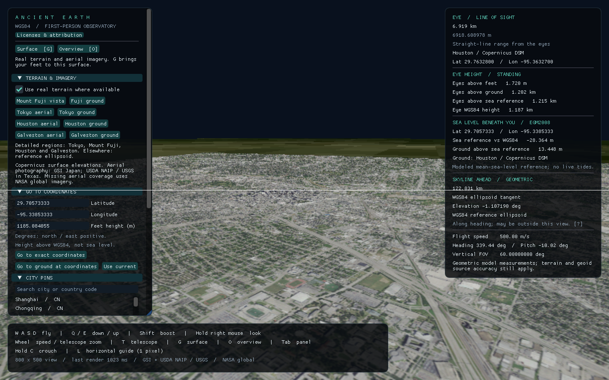

# Validation record

Latest validation: 2026-10-21. Platform: Windows x86_64, Rust 1.97.1. Earlier records below describe their respective revisions.

## Repository publication screenshots

Three fresh, unmodified native DirectX 12 captures accompany the initial full-project publication: [ground and grass](../images/github-ground.png), [weather controls](../images/github-weather.png), and [F2 with L/V](../images/github-clean-guides.png). They were captured and inspected at 1920×1080 before pushing the repository. The weather view uses the explicitly labeled fixed NOAA verification snapshot; the high-altitude clean view identifies geometric fallback. Source terms, credits and hashes are retained in the asset inventory. No runtime or scientific equations changed for publication.

The repository's `.gitattributes` preserves exact asset, provenance, license-source and lockfile bytes across Windows and Unix checkouts. Build outputs, mutable weather caches and temporary QA artifacts remain excluded from Git.

## Optional live weather and clean-view guides

**Weather & Refraction → Enable weather refraction** now controls NOAA GFS ingestion and the curved-ray display. It starts disabled. Live profiles follow the in-app observer location and real computer UTC; the astronomy calendar remains independent. Downloading, stale data, source times and failures have explicit status. The fixed verification snapshot requires the separate `--weather-reference` option and is never a silent network fallback. F2 hides panels and the dot while preserving independent L/V toggles, captions and adjustment.

All **176 Rust workspace tests** passed, including **148 mathematical test groups**, of which **14** cover atmospheric optics and independent review. Strict all-target Clippy and formatting passed. Logs are `artifacts/weather-tests-final.log`, `artifacts/weather-clippy-final.log` and `artifacts/weather-review-final.log`. The final formatting correction affected test assertions only. Environment-specific incremental-cache hard-link warnings used the successful copy fallback.

Mathematics specialists implemented the optical model, weather mapping, shader and guide integration; a separate reviewer checked equations, numerical cases, source decoding and display behavior. Independent GDAL/Rasterio decoding reproduces the registered NOAA fixture with `python scripts/verify_weather.py --check`. The [scientific verification record](../science/verification.md#optional-weather-informed-optical-paths) states the fixtures, tolerances and finite accuracy limits. Passing these checks does not certify the atmosphere at a real observer's location.

Native DirectX 12 captures were inspected at 1920×1080:

| Capture | Observed behavior |
| --- | --- |
| [Weather controls and coast](../images/weather-reference-coast.png) | Explicit verification source, enable toggle, timestamps, atmospheric measurements and smooth surface |
| [Refracted horizon](../images/weather-horizon-refracted.png) / [geometric comparison](../images/weather-horizon-geometric.png) | Magnified model horizon shifts with refraction; the one-pixel L guide remains aligned |
| [F2 with both guides](../images/weather-clean-guides.png) | Panels and dot are hidden; L/V captions, marker and lines remain visible over the Earth curve |
| [Fisheye and imperial units](../images/weather-fisheye.png) | Active curved-ray circular projection with both guides and imperial captions |
| [High-altitude fallback](../images/weather-overview-check.png) | Geometric globe view with an explicit altitude-limit status, also in clean view |
| [Moon telescope](../images/weather-moon.png) | The Moon remains visible through the optical display with a modeled range |

Independent native-pixel inspection of the magnified horizon finds L on row 521 with refraction and row 558 without it, each one physical row thick. The independently predicted unsnapped shift is 37.302311 pixels. These are checks of this declared model and lens, not an observation of the real horizon. The geometric capture predates later optical presentation and status changes; its geometric path is unchanged. All captures retain procedural appearance without photographic imagery, topographic relief or city markers.

A separate native `--coast --weather` run downloaded and rendered a live NOAA profile: model run 2026-10-21 12:00 UTC, valid at 20:00 UTC. The validated response SHA-256 was `30d965a53c0bde9a03d621e95c90c727bad4a831ff0ecee0ea87caa0959f2d49`. Its request, times and hash remain in the local QA cache; this mutable cache is not distributed. This run establishes actual network integration, not future provider availability.

The optional optical mode is currently expensive. A stationary **debug build, DirectX 12, Radeon RX 7900 XTX, 1920×1080, AutoVsync** capture with the fixed NOAA snapshot, a 60° rectilinear coast view, clean view and **L/V disabled** recorded 256 frame intervals over 20.1029381 seconds after warmup. Throughput was **12.7 FPS**, median interval **80.6 ms**, and 95th-percentile interval **152.9 ms**. There were no unfocused, incomplete-scene or changed-view samples. The independently checked figures come from `artifacts/performance/weather-coast.json`; they measure application frame intervals, not GPU execution time or a moving/default-HUD benchmark. This revision does not meet an AAA frame-rate target.

Current optical display support ends at 20 km WGS84 eye height. Higher views consistently use geometric rendering and measurements while retaining downloaded weather. Within the supported range, unresolved individual optical rays are marked purple. Active optical mode hides decorative grass and its shadows and uses simplified lighting; switching it off restores the PBR scene. Coarse forecasts cannot resolve every local inversion or actual mirage. See [the optical model](../science/refraction.md) and [display limits](../science/rendering.md).

The asset audit passes for **71 reviewed assets**, including the fixed NOAA snapshot and these seven unmodified captures, with provider terms and attribution retained. The new Windows dependency graph adds 34 packages without changing previously locked versions; embedded fonts are unchanged. Actual dependency terms, bundled WMO table licenses and the certificate-root data license were reviewed, retained in the notices and verified with the software-license checker. Six asset-auditor regression tests pass. Distribution uses the Windows packager so the source notices, documentation and provenance accompany the executable.

## Smooth WGS84 surface and boundary-only data

The current application removes the city catalog, importer, browser, pins, pin selection and named location shortcuts. GPS entry remains. Land, ocean, lakes and rivers share the smooth WGS84 ellipsoid at height zero. No topographic elevation or photographic imagery files are loaded. The separate EGM2008 datum readout does not displace the surface. Regional source water masks supply classification and boundaries only; outside their coverage the surface is explicitly unclassified.

All **153 Rust workspace tests** passed, including **134 mathematical test groups**. Final strict all-target Clippy and formatting passed. Logs are `artifacts/boundary-tests.log`, `artifacts/boundary-clippy-final.log` and `artifacts/boundary-build.log`. The final initializer-style lint corrections were checked again with the affected navigation, boundary and reference-frame tests; they do not change runtime behavior. Incremental-cache hard-link warnings used the compiler's successful copy fallback.

The mathematical implementation, preprocessing and scientific documentation received independent review. Seven boundary review groups exercise the analytic ground, ranges, skyline, navigation, grass and regional/global mesh joins. Four Python geometry groups and the separate source verifier pass. The [scientific verification record](../science/verification.md#current-smooth-wgs84-surface-and-height-free-boundaries) records the full input audit, numerical scope and limits. `prepare_boundaries.py --check` regenerated all four height-free boundary assets and provenance identically; the log is `artifacts/boundary-reproduction.log`. This importer reads water-mask inputs without DEM or geoid elevation inputs.

Five native DirectX 12 captures were inspected at 1920×1080. The coast, ground, fisheye and telescope views use the generic `--coast` entry point with time paused at 2026-10-21 18:00:00 UTC:

| Capture | Observed behavior |
| --- | --- |
| [Coast](../images/boundary-coast.png) | Level land and water meet at the reconstructed mask boundary; the former raised regional boundary no longer forms a horizon wall |
| [Ground](../images/boundary-ground.png) | Grass remains grounded with visible shadows; the underlying surface has no topographic relief |
| [Overview](../images/boundary-overview.png) | Generic globe overview without city markers; uncovered areas retain the unclassified material |
| [Fisheye and guides](../images/boundary-fisheye.png) | Circular projection, imperial measurements and both L/V captions remain readable at original image resolution |
| [Telescope](../images/boundary-telescope.png) | Magnified land surface and range HUD remain coherent; this frame does not establish magnified coastline detail |

The captures use the reviewed geometry revision. Later changes are test lint corrections, diagnostic wording and documentation/notices. Source-mask resolution, reconstructed contours, finite display triangles and regional coverage remain limits; these images establish integration rather than surveyed accuracy or frame-rate guarantees. The [atmospheric optics assessment](../science/atmospheric-optics-plan.md) was independently reviewed, but refraction and mirages are not implemented in this revision.

The asset audit passes for **63 reviewed assets**, including the four boundary files and five new unmodified native captures. Source permissions, credits, original product terms and modification notices remain intact. Removing the city importer/catalog removed the application's direct `serde` dependency; locked dependency versions, the transitive license inventory and embedded fonts did not change. Regenerated software notices were inspected and pass `--check`. The Windows packager includes documentation, notices and provenance with the executable.

## Shoreline refinement

The coastal update replaces coarse whole-cell ocean boundaries with a reconstruction from the existing native Copernicus elevation and water-mask samples. Original elevation files remain unchanged; the companions add coastal detail and change interpolation between source posts. Rendering, measurements, collision and grass placement consume the same revised canonical surface. The [water model](../science/water.md) documents the independently reviewed reconstruction and its limits.

The Terrain panel now has an **Along the coast** inspection preset, also available as `--galveston-shoreline`. Imagery remains removed. This revision reuses the already reviewed source files and introduces no runtime dependencies or fonts.

All **153 Rust workspace tests** passed with the final curved shoreline assets, including **129 mathematical test groups**. Strict all-target Clippy, formatting and tracked-file whitespace checks passed. Logs are `artifacts/shoreline-tests.log`, `artifacts/shoreline-clippy.log` and `artifacts/shoreline-build.log`. The environment's incremental-cache hard-link warnings use the compiler's successful copy fallback.

The independent source and geometry review checks every regional mesh against its original DSM, water mask and geoid inputs. The [scientific verification record](../science/verification.md#current-native-shoreline-reconstruction) records the tested construction, numerical results and limitations. An initial refinement was rejected in native QA because it still showed sharp steps; the accepted reconstruction removes that artificial diagonal constraint in ordinary coastal cells. Rendering, queries and navigation share the resulting geometry.

Four Python shoreline groups and three water classification/enclosure groups pass. `prepare_water.py --check` regenerates all four companions with identical binary bytes and complete provenance. The optional Python packages came from `scripts/requirements-terrain.txt`; this workspace used `$env:PYTHONPATH = (Join-Path (Get-Location) '.cache/python')` before running those commands. These development packages are not bundled with the executable.

The final DirectX 12 executable was captured and inspected at 1920×1080, with the calendar paused at 2026-10-20 18:00:00 UTC:

| Capture | Observed behavior |
| --- | --- |
| [Along the coast](../images/shoreline-along.png) | The large sharp triangular teeth are replaced by a connected rounded boundary; no visible gap or land/water overlap |
| [Coast / ocean view](../images/shoreline-coast.png) | Shallow ocean view retains water-target and eye-height readouts; the separate distant coverage boundary remains visible |
| [Fisheye](../images/shoreline-fisheye.png) | The rounded shoreline remains continuous through the circular projection with imperial readouts |
| [Telescope](../images/shoreline-telescope.png) | The magnified land/water boundary is clean; the center ocean target remains consistent with the ordinary view |

Native-scale scalloping remains. Smooth reconstruction does not add surveyed detail to the source mask. The distant regional boundary, illustrative shore materials and vegetation, broader coverage, tides and waves, and performance of the larger mesh remain separate work. These captures establish visible integration, not survey accuracy or a frame-rate guarantee.

The final asset audit passes for **55 reviewed assets**, including the four new unmodified native captures. Source permissions, credits, original product terms and modification notices remain intact. Software and embedded-font notices pass `--check`; the Windows packager includes those notices, the reviewed source provenance and these documents.

## Regional mapped water

The four bundled regions now load matching Copernicus Water Body Mask companions alongside the unchanged elevation files. Ocean, lake and river hits receive explicit surface labels. Water and mixed shoreline regions exclude grass. The Terrain panel and command line provide Galveston coast and on-water presets. Imagery remains removed. [Water methods and limits](../science/water.md) records the independently reviewed classification, height model and finite coverage.

All **149 Rust workspace tests** passed: 125 mathematical, 8 catalog/navigation, 12 desktop, 2 runtime geoid and 2 reference-frame application tests. Strict all-target Clippy and formatting passed. Logs are `artifacts/water-tests.log` and `artifacts/water-clippy.log`. Rust emitted environment-specific incremental-cache hard-link warnings while successfully copying the cache files; these were not code-lint failures.

The independent review added six Rust water groups and three Python classification/enclosure groups. The separate source verifier checks all companion classifications, original terrain hashes and ocean heights against the downloaded provider files and PROJ. The [scientific verification record](../science/verification.md) states the numerical scope and limits. Native captures are display-integration checks, not photometric validation, an ocean forecast or a performance benchmark.

The exact original EULA supplied with each of the four water masks was reviewed before importing data. The original license is included in distribution and its hash is now enforced by the asset auditor. Six license-auditor regression tests pass, including missing/changed original license rejection. Runtime dependencies and fonts are unchanged; the existing Windows software/font notices pass `--check`.

Native DirectX 12 captures were inspected at 1920×1080:

| Capture | Observed behavior |
| --- | --- |
| [Galveston overview](../images/water-galveston-overview.png) | Classified water surrounds the island and bay; source landforms remain intact |
| [Coast](../images/water-coast.png) | The center ray identifies mapped ocean while the observer remains above land |
| [Fisheye](../images/water-fisheye.png) | Water presentation and imperial measurements work through the circular projection |
| [Telescope](../images/water-telescope.png) | Smooth water shading at narrow field of view; the ocean hit and height readouts remain available |
| [Night](../images/water-night.png) | Water darkens with the scene and does not retain the daytime highlight |

Telescope inspection exposed an abrupt reflected-sky brightness transition. The mathematics rendering specialist replaced it with an independently reviewed smooth transition; a new native capture confirms the angular artifacts are gone. This is a material-only correction. The overview, coast and night captures precede that final reflection adjustment; telescope and fisheye captures include it. The distant reference-ellipsoid boundary remains visible in the ocean views and can determine the reported skyline. These captures do not establish a physical open-ocean horizon or fine shoreline accuracy; the [water limitations](../science/water.md#rendering-range-horizon-and-navigation) explain why.

The final asset audit passes for **51 reviewed assets**, including all four water companions and these five unmodified native captures. Each has a hash and retained source attribution. The Windows distribution script includes the original product EULA, source review, per-region provenance, software/font notices and documentation with the executable.

## Observer rotation lock and horizon rulers

F9 now switches between Earth-following and Earth-centered nonrotating observer constraints. L follows the highest detected visible Earth skyline and displays both chord and reference-ellipsoid geodesic widths. With L enabled, V displays a movable drop measurement using the explicitly defined camera-depth reference. Arrow keys and marker dragging select its column; units update all labels. Imagery remains removed and imported elevations are unchanged.

The final all-target workspace suite passed **142 Rust tests**: 119 mathematical, 8 catalog/navigation, 11 desktop controls/presentation, 2 bundled-geoid and 2 clock/tracker integration tests. Strict all-target Clippy, formatting and tracked-file whitespace checks passed. Raw results are in `artifacts/guides-final-tests.log` and `artifacts/guides-clippy-final.log`. Invalid guide demonstration names and non-finite column arguments were rejected in native command-line checks.

The independent mathematics review covered complete camera orientation, epoch handling, collision rejection, observer-versus-ground aberration, robust inverse geodesics, canonical skyline queries and ruler endpoints. A narrow terrain fixture exposed a vertical-search miss; the retained regression passes after adding canonical queries around the detected apex. See [scientific verification](../science/verification.md#observer-reference-frames-and-horizon-guides), [reference frames](../science/reference-frames.md), [guide definitions](../science/horizon-guides.md) and [geodesic scope](../science/geodesics.md). Finite skyline sampling remains an estimate; this revision does not claim exact observed terrain, tides or astronomical prediction for arbitrary dates.

Four unmodified native DirectX 12 captures were inspected at 1920×1080:

| Capture | Observed behavior |
| --- | --- |
| [Normal horizon](../images/guides-horizon-final.png) | L meets the visible crest; both widths and the vertical caption are readable; the footer fits |
| [Fisheye / HiDPI](../images/guides-fisheye-hidpi.png) | Circular projection, 1.5 display scale and imperial ruler labels; invalid aperture regions do not create horizons |
| [Tilted view](../images/guides-rolled.png) | The reference stays horizontal at the highest detected visible outline while Earth is tilted |
| [Sky-only view](../images/guides-sky.png) | Explicit unavailable-horizon message, with no fabricated ruler values |

Independent raw-pixel inspection confirms one physical row for L and one physical column for V in the normal and HiDPI captures. The [native evidence](../science/verification.md) records the exact rows, columns and qualifications. Initial inspection also led to opaque ruler captions and a larger help area. These checks establish display integration, not real-world measurement accuracy.

The asset audit passed for **42 reviewed assets**, including these four captures with hashes and inherited source terms. The new `geographiclib-rs` 0.2.7 dependency was reviewed under its MIT license with optional features disabled; its existing `libm` dependency was already locked. Software/font notices were regenerated, inspected and verified with `--check`. Five license-auditor regression tests passed. No imagery, terrain data or fonts were added.

The first Houston movement exercise with both rulers enabled passed movement, rebase, quality-change, grass-disable and recovery checks (`artifacts/guides-houston-motion.json`). It also exposed a substantial cost while recomputing the skyline. The reviewed optimization preserves sample counts and tolerances, memoizes identical pixel queries, short-circuits surface-occupancy checks and defers nearest-hit queries until endpoints are selected. The retained parity test compares occupancy with the canonical nearest query. This removes avoidable work, but synchronous current-pose skyline calculation can still reduce flight frame rate. The first run was unfocused; both runs are nonstationary integration checks and cost diagnostics, not stationary performance baselines.

The final optimized executable also passed the complete Houston movement exercise (`artifacts/guides-houston-motion-final.json`), with no unfocused recorded frames. The normal-horizon screenshot was recaptured from that executable; the other three captures retain the same projection, UI and canonical guide definitions tested before the query optimization.

## Solar eclipse shadows

This revision adds a spatial solar-eclipse field shared by ground and grass, an observer eclipse readout, and ground/space demonstrations for total, annular and partial eclipses. Playback and time stepping update the field. The existing elevation geometry and imagery-free materials remain in use. Sky brightness is illustrative, and decorative eclipse stars appear only during modeled totality; partial and annular daylight retain daytime star suppression.

All **121 Rust tests** passed: 102 mathematical tests, 8 catalog/navigation tests, 2 bundled-geoid tests and 9 desktop tests. Strict all-target Clippy, formatting and tracked-file whitespace checks passed. Native command-line checks rejected invalid or missing demonstration names and an overview option without a demonstration. The raw workspace test log is `artifacts/eclipse-final-tests.log`.

The new mathematical implementation, rendering formulas, reference generators and scientific documentation were independently reviewed. Ten CSPICE/ERFA reference cases regenerate successfully with `scripts/verify_eclipses.py --check`; the separate spherical-integral comparison also ran successfully. The [scientific verification record](../science/verification.md#solar-eclipse-evidence) gives numerical tolerances and measured differences, including the distinction between model agreement and physical accuracy. The [eclipse model](../science/eclipses.md) explicitly excludes exact observed contacts, lunar relief and calibrated atmospheric illumination.

Native DirectX 12 captures were inspected at 1920×1080:

| Capture | Observed behavior |
| --- | --- |
| [Dallas from space](../images/eclipse-dallas-globe.png), [later instant](../images/eclipse-dallas-later.png) | Compact umbra and broad penumbra move across the surface while the camera stays fixed |
| [Dallas totality](../images/eclipse-dallas-ground.png), [daylight comparison](../images/eclipse-daylight-ground.png) | Ground and sky darken during totality; the same ground camera is illuminated on the comparison date |
| [Houston partial eclipse](../images/eclipse-houston-partial.png), [ordinary daylight](../images/eclipse-houston-daylight.png) | Partial attenuation affects ground and grass over the unchanged Copernicus surface; final partial capture has no daytime star field |
| [Albuquerque annular eclipse](../images/eclipse-albuquerque-ring.png) | Telescope shows a continuous solar ring around the nearer Moon, with daytime stars suppressed |
| [Dallas fisheye](../images/eclipse-dallas-fisheye.png) | Totality and decorative stars remain visible through the complete circular projection |

The moving-shadow, totality, partial and annular views also received independent inspection. The Dallas daylight comparison uses `--eclipse-demo dallas --datetime "2024-04-09 18:42:00"`; the `none` preset is the separate Houston daylight case. The later space view uses the Dallas overview with `--datetime "2024-04-08 19:12:00"`. These are visual integration checks, not measured radiometry or a new performance benchmark.

The asset audit passed for **38 reviewed assets**, including these eight unmodified native captures with hashes and source credits. Locked software/font notices and the five license-auditor regression tests passed. Additional GeoNames demonstration-coordinate credits are preserved in `NOTICE.md`. No imagery, terrain downloads, dependencies or fonts were added.

## Ground and grass polish

This revision adds filtered procedural ground materials, curved grass with a denser low layer, GPU wind shared with the shadow pass, and daylight fill that keeps shadowed leaves readable. Grass preparation runs in the background; displayed geometry and its range-query data are replaced together. Measured terrain data and canonical terrain queries are unchanged. No imagery, external art packs, fonts or dependencies were added.

The mathematics implementation and scientific documentation were independently reviewed. The review includes anchored roots, distance fading, wind bounds, visible-triangle intersections, floating-origin material continuity, exposure ordering and asynchronous snapshot validity. See [the rendering model and limits](../science/rendering.md) and [scientific verification](../science/verification.md).

The final all-target workspace suite passed **111 Rust tests**: 92 math, 8 catalog/navigation, 2 bundled-geoid and 9 desktop tests. Strict all-target Clippy and formatting passed. The asset audit passed for **30 reviewed assets**, including five new native documentation captures. Locked software/font notices, five license-auditor regressions and three frame-analysis test groups passed. No dependencies or fonts changed.

Native DirectX 12 captures were inspected on the RX 7900 XTX:

| Capture | Observed behavior |
| --- | --- |
| `artifacts/polish-houston-final.png` | Readable curved grass, low turf layer, source-backed ground and clean terrain outline |
| `artifacts/polish-low-sun-final.png` | Long directional shadows with readable shadowed ground and leaves |
| `artifacts/polish-fuji-final.png` | Preserved mountain silhouette with restrained distant material shading |
| `artifacts/polish-fisheye-final.png` | Complete circular view without an evident cube-face seam |
| `artifacts/polish-night-final.png` | Centered Moon and decorative stars; no daylight fill leaking into night |
| `artifacts/polish-galveston-hidpi-final.png` | Crouched camera, sea-reference readouts and independently checked one-pixel guide at 150% scale |
| `artifacts/polish-no-grass-final.png` | Grass hidden while terrain and scientific measurements remain active |

All selected final captures are native 1920×1080 images. Automated screenshots can use `--capture-fullscreen` to avoid Windows work-area clamping, and gameplay input is suppressed during screenshot/frame-capture automation. Normal interactive navigation and F5 remain available outside those automated modes.

Representative captures: [Houston](../images/polish-houston.png), [low sunlight](../images/polish-low-sun.png), [Fuji](../images/polish-fuji.png), [fisheye](../images/polish-fisheye.png) and [night](../images/polish-night.png). These are unmodified native renders. Their source credits and hashes are recorded in `licenses/assets.json`.

The work improves the procedural presentation; it does not establish finished AAA art quality or surveyed vegetation. Distant grass coverage is finite, fast travel can temporarily outpace preparation, and the source terrain resolution still limits visible landform detail.

### Measured application frame pacing

The final captures used the debug executable, DirectX 12, an AMD Radeon RX 7900 XTX (driver `32.0.31041.1004`), a 1920×1080 window and `AutoVsync`. Both began at Houston ground level with Balanced quality, grass and terrain enabled, a 60° rectilinear view, and the UI, panels and pins visible. The astronomical clock was paused at 2026-10-20 18:00:00 UTC. Gameplay input was suppressed during automation; both runs remained focused.

Recording began after the requested scene was ready and both warmup thresholds had passed: 120 frames and 10 seconds. Every subsequent complete frame interval was retained, including preparation stalls during motion. Statistics were independently recalculated from the raw intervals using high-precision decimal sums and sorted nearest-rank percentiles.

| Run | Frames | Duration (s) | Aggregate FPS | Mean (ms) | Median (ms) | p95 (ms) | p99 (ms) | Maximum (ms) |
| --- | ---: | ---: | ---: | ---: | ---: | ---: | ---: | ---: |
| Stationary Houston | 1,186 | 20.017004 | 59.250 | 16.878 | 16.670 | 22.777 | 33.126 | 41.204 |
| Scripted motion and recovery | 1,017 | 20.020081 | 50.799 | 19.685 | 18.591 | 31.544 | 42.146 | 270.238 |

The accepted stationary report, `artifacts/polish-houston-stationary-final.json`, records no view changes, incomplete-scene frames or unfocused frames. An earlier input-contaminated capture remains in `artifacts/polish-houston-frames.json`; it is ineligible and is not used in this table.

The motion report, `artifacts/polish-motion-frames.json`, passed the native integration probe: flight triggered an origin rebase, geometry and query-bound counts remained matched, a quality change advanced the generation, disabling grass cleared both counts, and restoring grass and quality reached two continuous seconds of ready state. All 254 frames marked incomplete during preparation remain in the statistics. Final recovery was confirmed 9.771 seconds into recording; the remainder of this run therefore includes the recovered stationary view. This is a state-transition check, not a pixelwise GPU comparison or a sustained-flight benchmark.

These numbers measure application pacing, including scheduling and VSync, on this machine and configuration. Aggregate FPS is frame count divided by total recorded time; it is not the mean of reciprocal frame intervals. The 270.238 ms motion frame is a real recorded hitch, so these results do not establish stall-free travel or stable 60 FPS during movement. They do not measure GPU execution time or release-build performance. Reproduce the analysis with [`scripts/analyze_frame_capture.py`](../../scripts/analyze_frame_capture.py); the [measurement protocol](../science/verification.md#reproducible-frame-pacing) documents eligibility and watchdogs.

## GPU terrain and astronomy revision

The default-feature workspace suite passed **100 Rust tests**: 87 math, 8 catalog/navigation, 2 bundled-geoid and 3 desktop-control tests. The last group includes restoring window dimensions, position and DPI after fullscreen. The independently reviewed headless suite contains 97 tests. Strict all-target Clippy and Rust formatting passed. The incremental-cache hard-link warning only caused fallback file copying.

All four independent astronomy regeneration checks passed: ERFA orientation tables, 787 TDB coefficients, six complete Earth-orientation matrices, and CSPICE/ERFA state/time/apparent-position fixtures. The mathematics implementation and scientific documentation were separately reviewed; [scientific verification](../science/verification.md) records the independent references and accuracy limits.

The asset audit passed for **25 reviewed assets**, including the five new documentation captures. Locked software/font notices and five license-auditor regression tests passed. No photographic imagery is loaded by this renderer; retained older photographic assets and screenshots below are historical records.

Native DirectX 12 captures on the RX 7900 XTX were visually inspected:

| Capture | Verified behavior |
| --- | --- |
| `artifacts/gpu-houston-final.png` | Native 1920×1080 terrain, short grass, clean shadows, sea/eye/skyline readouts and horizontal guide |
| `artifacts/gpu-galveston-hidpi-final.png` | Crouched camera, visible-grass range, negative coastal ellipsoid heights, 150% UI scaling and guide |
| `artifacts/gpu-fuji-final.png` | Source-backed mountain geometry, procedural material and clear mountain outline |
| `artifacts/gpu-reference-final.png` | Same Fuji pose with terrain disabled; ellipsoid horizon replaces the mountain and HUD switches surface |
| `artifacts/debug-sync-fisheye.png` | Six-view GPU rendering and complete circular equidistant view of Fuji |
| `artifacts/gpu-sun-final.png` | Sun centered by the aim control, telescope view and qualified apparent-sphere range |
| `artifacts/debug-sync-moon.png` | Centered Moon, phase shading, telescope view and qualified apparent-sphere range |
| `artifacts/debug-sync-night.png` | Night sky, decorative stars and Moon in normal perspective |

These captures exited successfully. Native checks caught and corrected shadow acne and incomplete views during asynchronous shader preparation. Shader preparation is now synchronous, with a possible first-use pause. The unrelated unavailable-gamepad diagnostic remained; no driver or registry settings were changed. These are visual smoke tests, not sustained frame-rate benchmarks or proof of AAA art quality.

Independent final inspection confirmed one full-width physical guide row in both the normal-scale Houston and 150%-scale Galveston captures. The scientific review also checked the Sun/Moon raster sizes and the fisheye aperture; see [final native review](../science/verification.md#final-native-review).

Representative native captures: [Houston](../images/gpu-houston.png), [Fuji](../images/gpu-fuji.png), [fisheye](../images/gpu-fisheye.png), [Moon](../images/gpu-moon.png) and [night sky](../images/gpu-night.png). Screenshot source credits are preserved in `licenses/assets.json` and `NOTICE.md`.

## Sea reference, eye height, crouch and skyline revision

The final default-feature workspace test run passed **78 tests**: 66 math tests, 8 catalog/navigation tests, 2 tests of the actual bundled geoid decoder, and 2 desktop keyboard-control tests. The independently reviewed headless suite passed 76 tests. All-target strict Clippy, formatting, five license-check regression tests, asset attribution/hash checks and locked software/font notices passed.

The mathematical implementation and scientific documentation received independent review. See [scientific verification](../science/verification.md) for the external fixtures, terrain-edge qualifications and numerical limits.

The rebuilt Windows executable was tested with DirectX 12 on the RX 7900 XTX:

| Native capture | Check |
| --- | --- |
| `artifacts/observation-houston-complete.png` | Flying view, current-location sea reference, ground/eye heights, skyline range and horizontal guide |
| `artifacts/observation-galveston-crouch-complete.png` | Crouched camera, coastal negative ellipsoid heights, updated dot distance and qualified skyline estimate |
| `artifacts/observation-hidpi-complete.png` | 150% display scale, scrollable panels above the footer and physical-pixel guide |

All three final captures exited successfully and were visually inspected. Earlier standing/crouching comparisons verified both postures. Independent pixel checks of native captures at normal and 150% scaling found exactly one full-width guide row and no guide pixels in adjacent rows. The control tests verify release-to-stand, GUI capture, the persistent crouch checkbox and one L toggle per key press. The screenshot-only `--test-hidpi` switch exercises scaling without changing Windows settings.



These captures were made concurrently with validation work; the displayed last-render times are not a performance benchmark. The existing unrelated gamepad diagnostic remained. No driver or system settings were changed.

## Earlier terrain revision

The Houston/Galveston revision's complete headless suite passed: **62 tests, zero failures** (54 math and 8 application tests). Four independent Python imagery tests and five license-check regression tests also passed. Strict all-target Clippy and Rust formatting passed. The native Windows build and visual checks are recorded below.

| Check | Result |
| --- | --- |
| Headless tests | 62 passed |
| Desktop build | Passed; `target/debug/ancient-earth.exe` |
| Desktop all-target compilation | Passed |
| Strict all-target Clippy | Passed, no code lint failures |
| Rust formatting and diff whitespace | Passed |
| Rectilinear overview | Globe, pins and center sight range rendered |
| Ground view with imperial units | Eye-level surface view and feet range rendered |
| Equidistant fisheye | Circular aperture, globe and projected pins rendered |
| Telescope | Narrow rectilinear view and magnification rendered; central range unchanged |

The original representative overview is stored at `docs/images/overview.png`. Other captures are local files under the ignored `artifacts/` directory. These are actual native-window captures, not mockups.

The tested machine emitted diagnostics about stale Vulkan SDK/overlay layer registrations and an unavailable gamepad. The four app processes still exited successfully and produced valid screenshots. Host driver or registry settings were not changed.

### DirectX 12 startup verification

On 2026-10-20, the existing debug executable was also launched with `WGPU_BACKEND=dx12` and `--screenshot artifacts/overview-dx12.png` on the AMD Radeon RX 7900 XTX. It exited with code 0 and produced a screenshot that was visually checked for the globe, pins, navigation panel and range HUD. No Vulkan layer manifest errors appeared. A separate gamepad diagnostic remained. See the [Windows startup workaround](../user-guide.md#windows-startup-diagnostics).

### Terrain revision native verification

The updated debug executable was rebuilt and tested on 2026-10-20 using DirectX 12. Six final native captures exited successfully and were visually inspected:

| Capture | Observed behavior |
| --- | --- |
| `artifacts/terrain-fuji-final.png` | Raised Mount Fuji geometry, registered aerial imagery, terrain range label |
| `artifacts/terrain-tokyo-final.png` | Tokyo aerial mosaic, surface geometry and city pin |
| `artifacts/terrain-ground-final.png` | Eye-level placement on the Fuji mesh with a terrain sight range |
| `artifacts/terrain-reference-final.png` | Same vista pose in reference mode; mountain removed and HUD identifies ellipsoid ground |
| `artifacts/terrain-fisheye-final.png` | Circular fisheye aperture with terrain and the same center range |
| `artifacts/terrain-telescope-final.png` | Magnified terrain with the same center range |

Representative images are stored at [Mount Fuji](../images/terrain-fuji.png) and [Tokyo](../images/terrain-tokyo.png). Final captures used the rebuilt executable containing the independently reviewed terrain and bilinear image filtering. Asset SHA-256 values match their provenance records.

Terrain rendering remains CPU intensive. At the default 800 × 500 working resolution, the final individual captures reported last-render times of 193 ms for Fuji vista, 386 ms for Tokyo aerial and 390 ms for Fuji ground on the Ryzen 5 5500. These are individual image-render measurements, not a sustained frame-rate benchmark. A stationary view is cached; **Fast / 480** reduces work during movement. The math crate is compiled with optimization level 3 in development builds.

## Mathematical review

A dedicated mathematics agent implemented the library and a separate mathematics reviewer examined the formulas, numerical conditioning and application integration. The review added independent fixtures and adversarial tests rather than relying only on forward/inverse roundtrips.

The suite includes 11 original implementation tests, 21 original independent review tests, 3 terrain asset/projection tests and 19 independent terrain review tests. Cases cover published GeographicLib and EPSG coordinates, poles, the date line, negative heights, the supported altitude limits, exact unit definitions, eye-height range, nonunit rays, tangency, surface collision, both projections, very narrow telescope fields, pin occlusion, resize alignment and continuous flight across both poles.

Terrain review checks analytic plane intersections, BVH results against brute-force triangle tests, shared edges and vertices, negative terrain, coverage masks, both eligible ellipsoid roots, exact navigation rejection, fast collision, supported-domain checks and bilinear image sampling. An independent source check verifies all 222,130 bundled heights against the original Copernicus raster posts plus PROJ's geoid operation; this is reproducible with [verify_terrain.py](../../scripts/verify_terrain.py). Agreement establishes processing consistency, not survey accuracy.

### Houston, Galveston and licensing

Native DirectX 12 captures on 2026-10-20 exited successfully and were visually inspected:

- `artifacts/texas-houston.png`: Houston NAIP photography, highway network, Copernicus surface/range labels.
- `artifacts/texas-galveston.png`: island, shoreline, offshore imagery boundary and terrain range.
- `artifacts/texas-galveston-ground.png`: feet and eyes retain negative ellipsoidal heights, with a local terrain sight range.
- `artifacts/texas-licenses-final.png`: embedded source credits and required redistribution notices, positioned clear of the navigation panel.

Representative images are [Houston](../images/terrain-houston.png) and [Galveston](../images/terrain-galveston.png). Ground-level photography remains coarse; no individual building geometry or street-level detail is claimed. The new regions are local patches, not continuous coverage between the cities.

Independent Python checks compare actual USGS export extents with PROJ, verify returned image dimensions/hashes and confirm opaque imagery at both exact GeoNames city points. Alpha-aware filtering and fallback have dedicated Rust regressions. The downloaded source year is 2022; retrieval and service-credit dates are recorded separately.

Asset audit checks reject unreviewed files, changed assets/provenance, unknown/noncommercial sources and missing credits. Software notices are checked against the locked Windows graph, exact-version supplemental licenses, embedded fonts and Rust runtime notices. `--licenses` was verified to print the embedded notices without starting graphics. The packaging script includes the executable, license notices, inventories and user documentation. The generated ZIP passed CRC checks; its executable and notice bytes matched the local build. PE import inspection identified the Microsoft Visual C++ v14 runtime prerequisite, documented in the user guide and package startup instructions.

See [the detailed verification report](../science/verification.md) for sources, tolerances and corrected findings. Passing these numerical tests does not certify real-world terrain, GPS source accuracy or unlimited resolution.

## Application regression checks

Eight application tests cover catalog integrity and navigation:

- Original coordinate strings match parsed coordinates.
- Duplicate or altered catalog records are rejected.
- City navigation lands at the source point and selects the correct record.
- Valid coordinate entry preserves its exact requested values.
- Invalid or unsupported input leaves the observer and selection unchanged.
- Unit and telescope selection preserve the observer's physical state.
- Terrain city navigation preserves the catalog coordinates and lands on the loaded surface.
- An exact destination below the terrain is rejected; ground navigation lands on the available surface.

Headless command:

```powershell
cargo test --workspace --no-default-features --locked --offline --target-dir target/headless
```

Desktop compile, lint and format commands:

```powershell
cargo check --workspace --all-targets --locked --offline
cargo clippy --workspace --all-targets --locked --offline -- -D warnings
cargo fmt --all -- --check
git diff --check
```

The local sandbox can report that incremental-cache hard links are unavailable and copies are being used. That is a cache-performance warning, not a numerical test failure.

## Interactive acceptance checks

When changing controls or UI layout, exercise the following in the native app:

1. Confirm that no city catalog, location preset or pin remains; GPS entry and free flight must remain available.
2. Enter valid coordinates, then invalid latitude and a height below the active surface; rejection must leave position unchanged. Use **Go to ground at coordinates** to land on the available surface.
3. Switch metric/imperial while standing still; the position and physical range must stay fixed.
4. With weather disabled, look straight down and confirm model range follows eye height. Look upward into an unobstructed sky and confirm no surface intersection. Land and water must remain on the same smooth reference surface.
5. Fly with W/A/S/D and Q/E, adjust speed with the wheel, and check that editing a field does not fly the observer.
6. Toggle telescope, zoom, exit telescope, and verify restoration of the previous normal/fisheye view.
7. Resize the window and verify that the globe and center dot remain aligned; F5 must restore the previous window size after fullscreen.
8. Enable L/V, press F2, and verify that only panels/dot disappear. Toggle L and V while clean view remains active; move V with arrows and its draggable marker.
9. Release the right mouse, press Escape, and switch window focus to verify cursor release.
10. Enable weather at the current coordinates. Inspect the NOAA run/valid time and source grid; move to another grid location and confirm the former profile is removed until a valid replacement arrives. Disable the toggle and confirm ordinary grass/PBR rendering returns.
11. Check the explicitly labeled fixed reference snapshot, including normal, fisheye and telescope views. It must never silently appear after a failed live download. Change the astronomy calendar and confirm live weather still identifies real UTC separately.

Automated state tests and rendered screenshots do not replace every human interaction check in this list.
